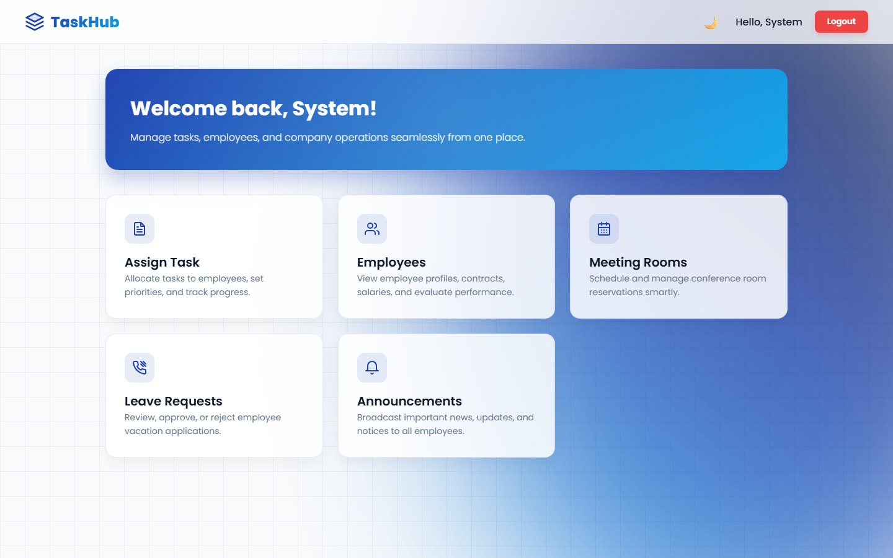
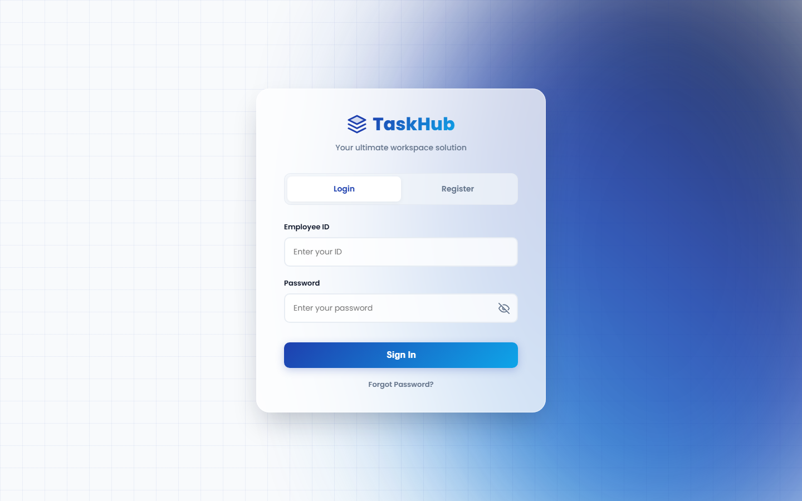
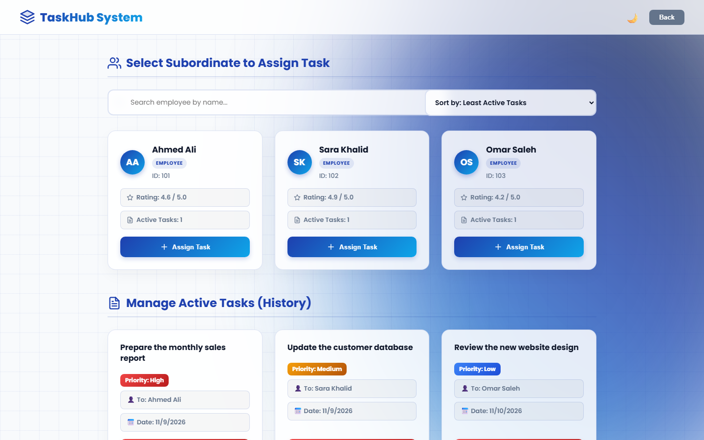

# TaskHub

**A workplace management web app for teams: tasks, leave requests, meeting rooms and announcements in one place.**

🔗 **Live demo:** https://yazeed-2.github.io/TaskHub/



## About

TaskHub helps a company organize its daily work. Managers assign tasks, review leave requests, book meeting rooms and post announcements. Employees see their own tasks, mark them as done and request leave. Each user only sees the pages that match their role.

The whole app runs in the browser with no server or installation needed.

## Features

**For managers**
- Assign tasks to employees with a priority level (High, Medium, Low) and an optional PDF attachment
- Search employees and sort them by workload or performance rating
- Rate completed tasks to track employee performance
- Approve or reject leave requests
- Post and manage company announcements

**For employees**
- Personal dashboard with active and completed tasks
- Submit leave requests and follow their status
- Read company announcements

**For everyone**
- Book meeting rooms and see upcoming meetings
- Sign up, sign in and reset a forgotten password
- Light and dark theme

**Super admin console** for managing all system accounts.

## Screenshots

| Sign in | Assign tasks |
|---|---|
|  |  |

## Try it

Open the [live demo](https://yazeed-2.github.io/TaskHub/) and sign in with one of these demo accounts:

| Role | Employee ID | Password |
|---|---|---|
| Manager | `admin` | `admin` |
| Employee | `101` | `123` |

You can also create your own account from the **Register** tab.

> Data is saved in your own browser (localStorage), so anything you add stays on your device only.

## Built with

- HTML5
- CSS3 (custom design, responsive layout, dark mode)
- JavaScript (no frameworks)
- Browser localStorage for data storage

## Run locally

1. Download or clone this repository:
   ```bash
   git clone https://github.com/Yazeed-2/TaskHub.git
   ```
2. Open `index.html` in any modern browser.

## Author

**Yazeed Alqahtani**, Information Technology student at Saudi Electronic University
